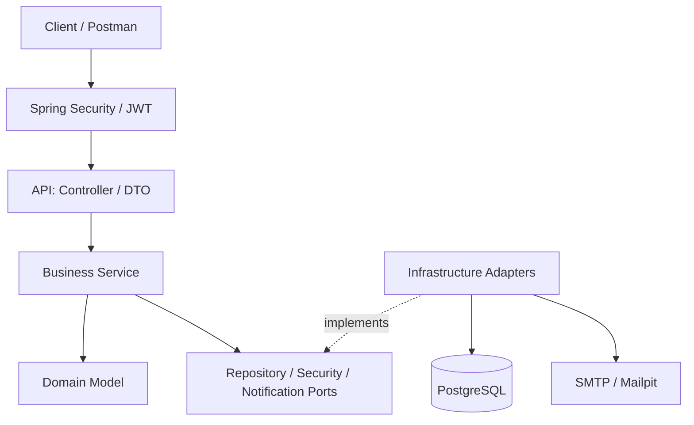

# Bus Booking System

## 1. Định nghĩa bài toán

### 1.1. Bối cảnh

Hiện nay, nhu cầu di chuyển bằng xe khách giữa các tỉnh, thành phố ngày càng phổ biến. Người dùng thường phải tìm kiếm thông tin chuyến xe, thời gian khởi hành, giá vé và số ghế còn trống thông qua nhiều nguồn khác nhau. Việc đặt vé theo phương thức thủ công có thể gây mất thời gian và khó quản lý thông tin đặt vé.

Bên cạnh đó, các nhà xe cần quản lý nhiều thông tin liên quan đến phương tiện, tuyến đường, lịch trình và vé đã được đặt. Nếu quản lý bằng phương thức thủ công, việc cập nhật số lượng ghế còn trống và theo dõi các lượt đặt vé có thể dễ xảy ra sai sót.

Vì vậy, hệ thống quản lý đặt vé xe khách trực tuyến được xây dựng nhằm cung cấp một nền tảng tập trung để người dùng tìm kiếm chuyến xe và thực hiện đặt vé, đồng thời hỗ trợ quản trị viên quản lý các dữ liệu cơ bản của hệ thống.

### 1.2. Vấn đề

Hệ thống tập trung giải quyết các vấn đề chính sau:

* Người dùng khó tìm kiếm và so sánh các chuyến xe phù hợp với nhu cầu di chuyển.
* Thông tin về tuyến đường, thời gian khởi hành, giá vé và số ghế còn trống cần được quản lý tập trung.
* Việc đặt vé thủ công gây khó khăn trong việc quản lý thông tin hành khách và số lượng vé.
* Số lượng ghế còn trống cần được cập nhật sau khi có booking.
* Người dùng cần có khả năng theo dõi các booking đã thực hiện.
* Quản trị viên cần có khả năng quản lý dữ liệu của hệ thống.

## 2. Chức năng và phạm vi

| Đối tượng | Chức năng chính |
|---|---|
| **Khách** | Tìm kiếm/xem chuyến xe, xem địa điểm, đăng ký và xác minh email bằng OTP |
| **USER** | Đăng nhập, cập nhật hồ sơ, đặt vé, xem lịch sử và hủy booking của mình |
| **ADMIN** | Quản lý nhà xe, phương tiện, địa điểm, tuyến đường, chuyến xe và tra cứu booking |
| **SUPER_ADMIN** | Có quyền của ADMIN và được nâng/hạ vai trò `USER` ↔ `ADMIN` |


## 3. Công nghệ sử dụng

* Java 21, Spring Boot
* Spring Security, JWT
* PostgreSQL, Spring Data JPA
* Swagger/OpenAPI
* JUnit, Mockito
* Docker, Docker Compose

## 4. Kiến trúc hệ thống

Ứng dụng là **modular monolith**, tổ chức theo **Layered Architecture kết hợp Ports & Adapters**. Business định nghĩa các interface (*ports*); tầng hạ tầng triển khai các adapter để làm việc với database, bảo mật và email.



| Nhóm | Công nghệ |
|---|---|
| Backend | Java 21, Spring Boot, Maven Wrapper |
| Dữ liệu | PostgreSQL, Spring Data JPA, Flyway (V1–V16) |
| Bảo mật | Spring Security, JWT, BCrypt, email OTP |
| API & kiểm thử | REST/JSON, Springdoc OpenAPI/Swagger, JUnit, Mockito, Locust |
| Môi trường | Docker cho các dịch vụ hỗ trợ/đóng gói khi được cấu hình |

## 5. Chạy nhanh trên Windows

**Yêu cầu:** JDK 21, PostgreSQL đang hoạt động, SMTP thử nghiệm (ví dụ Mailpit) và Maven Wrapper có sẵn trong repository.

1. Tạo database và tài khoản PostgreSQL dành cho BusBooking; kiểm tra cổng host đang sử dụng.
2. Khai báo biến môi trường `DB_URL`, `DB_USERNAME`, `DB_PASSWORD`, `JWT_SECRET`, `EMAIL_OTP_SECRET` và các biến `SMTP_*` theo [`06-running-guide.md`](docs/06-running-guide.md). Hai secret phải khác nhau; **Spring Boot không tự nạp file `.env` khi chạy trực tiếp**.
3. Mở PowerShell tại thư mục gốc và chạy:

   ```powershell
   $env:SPRING_PROFILES_ACTIVE = "dev"
   .\mvnw.cmd spring-boot:run
   ```

4. Khi backend đã khởi động, truy cập:
   - **Swagger UI:** http://localhost:8085/swagger-ui/index.html
   - **OpenAPI JSON:** http://localhost:8085/v3/api-docs

**Lưu ý:** Các URL trên dùng cấu hình local cổng `8085`, Swagger phải được bật. Cách chạy bằng Docker Compose (nếu bản bàn giao có cấu hình), thiết lập PostgreSQL/Mailpit, tạo secret và xử lý lỗi được hướng dẫn trong [Running Guide](docs/06-running-guide.md).

## 6. API và kiểm thử

- Danh sách đầy đủ: [API Design](docs/04-api-design.md).
- **Kiểm thử:** Unit test và integration test bằng JUnit/Mockito. Chạy `.\mvnw.cmd test` sau khi chuẩn bị **database test riêng** theo Running Guide.
- **Load test baseline (Kaggle CPU, Locust):** tại 20 người dùng ảo, GET Trip đạt khoảng **47,83 RPS** và POST Booking **46,84 RPS**, không ghi nhận lỗi Locust ở hai lượt đo. Đây là kết quả của môi trường thử nghiệm, **không phải cam kết hiệu năng tối đa**. Xem [báo cáo kiểm thử tải](load-tests/README.md).

## 7. Tài liệu project

| Tài liệu | Nội dung |
|---|---|
| [01 — Overview & Requirements](docs/01-overview-and-requirements.md) | Bài toán, đối tượng sử dụng, yêu cầu và nghiệp vụ |
| [02 — Database Design](docs/02-database-design.md) | ERD, bảng dữ liệu, ràng buộc và migrations |
| [03 — System Architecture](docs/03-system-architecture.md) | Các tầng, thành phần và hướng phụ thuộc |
| [04 — API Design](docs/04-api-design.md) | 32 endpoint, request/response và phân quyền |
| [05 — Source Code Design](docs/05-source-code-design.md) | Package, service, port, adapter và kiểm thử |
| [06 — Running Guide](docs/06-running-guide.md) | Cài đặt, cấu hình, chạy và khắc phục lỗi |
