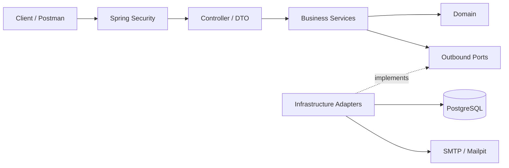

# Bus Booking System - Nền tảng đặt vé xe khách trực tuyến

## 1. Tổng quan đề tài

### 1.1. Bối cảnh

Hiện nay, nhu cầu di chuyển bằng xe khách rất phổ biến. Tuy nhiên, việc quản lý thông tin chuyến xe, lịch trình, số ghế còn trống và đặt vé vẫn có thể gặp nhiều bất tiện nếu được thực hiện thông qua các phương thức thủ công (phương thức truyền thống).

Về phía khách hàng, khó khăn trong việc tìm kiếm chuyến xe phù hợp và kiểm tra tình trạng ghế có thể mất nhiều thời gian, mất thời gian đi lại đến quầy để đặt vé.

Về phía nhà xe, việc quản lý chuyến xe, số lượng vé và thông tin hành khách cần đảm bảo tính chính xác, đặc biệt khi có nhiều yêu cầu đặt vé cùng lúc.

Vì vậy, hệ thống quản lý đặt vé xe khách trực tuyến được xây dựng nhằm cung cấp một nền tảng tập trung để người dùng tìm kiếm chuyến xe và thực hiện đặt vé, đồng thời hỗ trợ quản trị viên quản lý các dữ liệu cơ bản của hệ thống.

### 1.2. Vấn đề

Hệ thống tập trung giải quyết các vấn đề chính sau:

* Người dùng khó tìm kiếm và so sánh các chuyến xe phù hợp với nhu cầu di chuyển.
* Thông tin về tuyến đường, thời gian khởi hành, giá vé và số ghế còn trống cần được quản lý tập trung.
* Việc đặt vé thủ công gây khó khăn trong việc quản lý thông tin hành khách và số lượng vé.
* Số lượng ghế còn trống cần được cập nhật sau khi có booking.
* Người dùng cần có khả năng theo dõi các booking đã thực hiện.
* Quản trị viên cần có khả năng quản lý dữ liệu của hệ thống.

## 2. Chức năng và phạm vi pha 1

| Đối tượng | Chức năng chính |
|---|---|
| **Khách** | Tìm kiếm/xem chuyến xe, xem địa điểm, đăng ký và xác minh email bằng OTP |
| **USER** | Đăng nhập, cập nhật hồ sơ, đặt vé, xem lịch sử và hủy booking của mình |
| **ADMIN** | Quản lý nhà xe, phương tiện, địa điểm, tuyến đường, chuyến xe và tra cứu booking |
| **SUPER_ADMIN** | Có quyền của ADMIN và được nâng/hạ vai trò `USER` ↔ `ADMIN` |


## 3. Kiến trúc, công nghệ và tổ chức mã nguồn

BusBooking là **modular monolith**, kết hợp **Layered Architecture** với **Ports và Adapters**. Controller tiếp nhận HTTP; Business xử lý nghiệp vụ qua các interface (*ports*); adapter hiện thực truy cập dữ liệu, bảo mật và gửi email.



```text
src/main/java/com/example/busbooking/
├── api/           # Controllers, DTOs, mappers, validation
├── business/      # Services, commands, ports, results
├── domain/        # Models, enums, business exceptions
├── data/          # JPA entities, repositories, adapters, mappers
├── security/      # JWT, BCrypt, HMAC OTP, rate limiting
├── notification/  # SMTP email adapter
├── config/        # Cấu hình ứng dụng
└── exception/     # Chuẩn hóa lỗi HTTP
```

| Thành phần | Công nghệ và cách sử dụng |
|---|---|
| Backend | **Java 21, Spring Boot**, build/chạy bằng Maven Wrapper |
| Database | **PostgreSQL + Spring Data JPA**; **Flyway V1–V16** quản lý phiên bản schema |
| Bảo mật | **Spring Security, JWT, BCrypt**, email OTP; phân quyền theo vai trò |
| Tích hợp | **SMTP** gửi OTP; **Mailpit** hỗ trợ kiểm tra email khi phát triển |
| API và kiểm thử | REST/JSON, Springdoc OpenAPI/Swagger, JUnit, Mockito, Locust |
| Môi trường | Có thể dùng Docker cho PostgreSQL/Mailpit; cách chạy container phụ thuộc cấu hình repository |

## 4. Cấu hình và chạy nhanh (Windows / PowerShell)

**Cần có:** JDK 21, PostgreSQL, SMTP (có thể dùng Mailpit) và source code chứa `pom.xml`, `mvnw.cmd`.

1. Chuẩn bị database PostgreSQL và SMTP; xác nhận địa chỉ/cổng đang sử dụng.
2. Cấu hình biến môi trường `DB_URL`, `DB_USERNAME`, `DB_PASSWORD`, `JWT_SECRET`, `EMAIL_OTP_SECRET` và `SMTP_*` theo [Running Guide](docs/06-running-guide.md). Hai secret phải độc lập; **Spring Boot chạy trực tiếp không tự đọc `.env`**.
3. Từ thư mục gốc repository, chạy:

   ```powershell
   $env:SPRING_PROFILES_ACTIVE = "dev"
   .\mvnw.cmd spring-boot:run
   ```

Khi kết nối database thành công, **Flyway kiểm tra/áp dụng các migration** khi ứng dụng khởi động. Với cấu hình local cổng `8085`, mở [Swagger UI](http://localhost:8085/swagger-ui/index.html) để thử API. Repository có `compose.yaml` cho PostgreSQL, backend và Mailpit; backend publish cổng `8086`. Xem cổng, bootstrap và hạn chế SMTP của profile `dev` tại [Running Guide](docs/06-running-guide.md).

## 5. API và kiểm thử

- Tài liệu api đầy đủ: [thiết kế API](docs/04-api-design.md); Swagger cung cấp đặc tả tại `http://localhost:8085/v3/api-docs` khi backend chạy và docs được bật.
- **File api json:** [api json file](docs/openapi.json)

- **Kiểm thử tự động:** JUnit/Mockito và integration test; chạy `.\mvnw.cmd test` sau khi cấu hình **database test riêng** như Running Guide.
- **Load test Pha 1 (Kaggle CPU, Locust):** tại 20 người dùng ảo, snapshot CSV ghi GET **2.834 request / 48,01 RPS**, POST **2.789 / 47,21 RPS**; console cuối lượt ghi tương ứng **2.864 / 48,05 RPS** và **2.816 / 47,16 RPS**. Cả hai nguồn ghi 0 lỗi; nguyên nhân chênh lệch và mốc thống kê chuẩn **chưa xác minh**. Đây là *baseline thử nghiệm*, không phải giới hạn hiệu năng của hệ thống. Xem [kết quả kiểm thử tải](load-tests/README.md).

## 6. Tài liệu chi tiết của project

| Tài liệu | Nội dung |
|---|---|
| [01 Overview and Requirements](docs/01-overview-and-requirements.md) | Yêu cầu, actors, nghiệp vụ |
| [02 Database Design](docs/02-database-design.md) | ERD, ràng buộc, Flyway migrations |
| [03 System Architecture](docs/03-system-architecture.md) | Thành phần, kiến trúc và hướng phụ thuộc |
| [04 API Design](docs/04-api-design.md) | Các API, phân quyền và hợp đồng |
| [05 Source Code Design](docs/05-source-code-design.md) | Tổ chức packages, services, ports và adapters |
| [06 Running Guide](docs/06-running-guide.md) | Cấu hình, khởi chạy, kiểm tra và xử lý lỗi |

