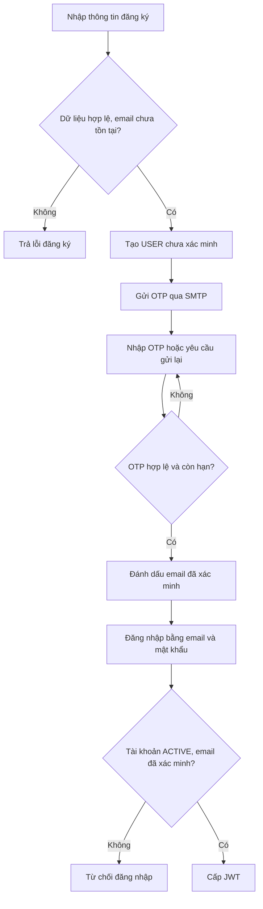
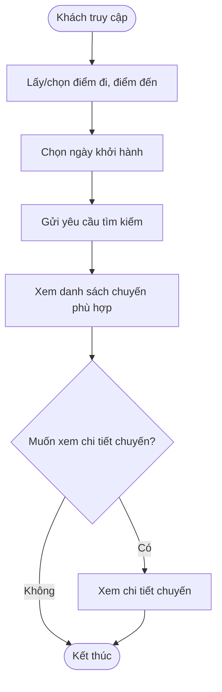
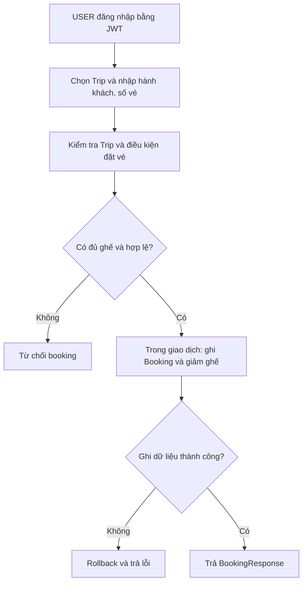
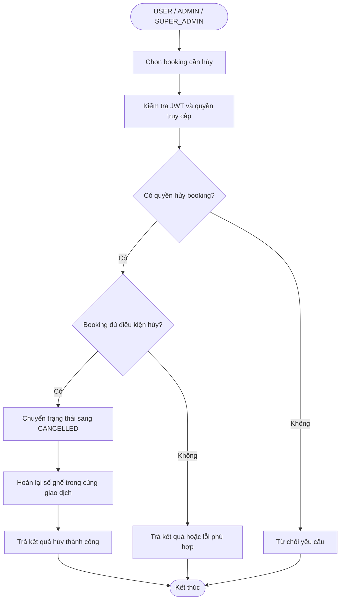
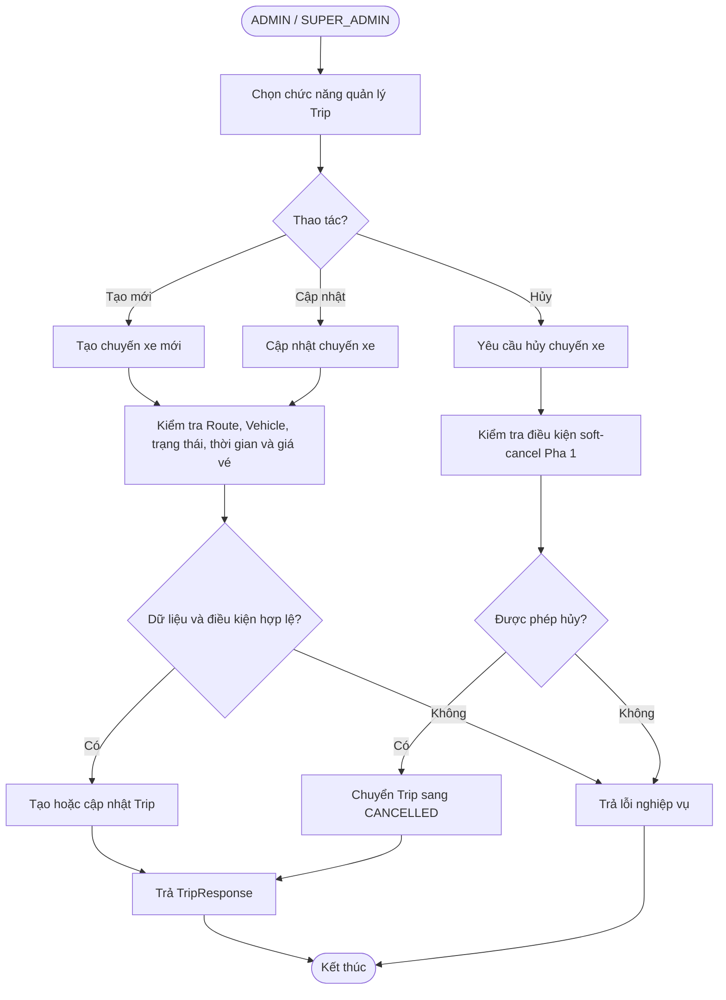

# 1. Tổng quan và yêu cầu hệ thống

## 1.1. Mục tiêu hệ thống

**BusBooking** là hệ thống backend phục vụ tra cứu chuyến xe khách và đặt vé qua REST API. Hệ thống hướng tới các mục tiêu:

- Cho phép người dùng đăng ký tài khoản, xác minh email bằng OTP và đăng nhập bằng JWT.
- Cung cấp dữ liệu địa điểm, tìm kiếm chuyến xe theo điểm đi, điểm đến và ngày khởi hành; xem thông tin chuyến, giá vé và số ghế còn trống.
- Cho phép người dùng đặt vé, xem lịch sử/chi tiết đặt vé và hủy vé theo quy tắc nghiệp vụ.
- Cho phép quản trị viên quản lý nhà xe, địa điểm, phương tiện, tuyến đường, chuyến xe và tra cứu booking.
- Kiểm soát quyền truy cập theo vai trò, kiểm tra quyền sở hữu booking và duy trì tính nhất quán số ghế khi đặt/hủy vé.
- Cung cấp API dạng HTTP/JSON, có đặc tả OpenAPI để phục vụ kiểm thử, tích hợp và bàn giao cho nhóm Pha 2.

BusBooking Pha 1 tập trung vào **backend và nghiệp vụ cốt lõi**, chưa phải một nền tảng thương mại vận tải đầy đủ.

## 1.2. Phạm vi hệ thống

### 1.2.1. Trong phạm vi Pha 1

- **Tài khoản và bảo mật:** đăng ký, xác minh/gửi lại OTP email, đăng nhập, lấy thông tin người dùng, cập nhật hồ sơ, phân quyền `USER` / `ADMIN` / `SUPER_ADMIN`.
- **Tra cứu công khai:** lấy danh sách địa điểm, tìm kiếm chuyến xe và xem chi tiết chuyến xe.
- **Đặt vé:** tạo booking, xem booking của mình, xem chi tiết booking, hủy booking và hoàn ghế khi hủy hợp lệ.
- **Quản trị danh mục:** xem danh sách, tạo và cập nhật nhà xe, địa điểm, phương tiện, tuyến đường; kiểm soát trạng thái và ràng buộc liên quan.
- **Quản trị vận hành:** xem danh sách, tạo, cập nhật, hủy chuyến xe (đổi trạng thái, không xóa bản ghi) và tra cứu booking toàn hệ thống.
- **Quản lý vai trò:** chỉ `SUPER_ADMIN` được nâng/hạ vai trò giữa `USER` và `ADMIN` theo điều kiện hệ thống.
- **Tài liệu và kiểm thử:** Swagger/OpenAPI, kiểm thử chức năng và bộ baseline kiểm thử tải Pha 1.

### 1.2.2. Ngoài phạm vi Pha 1

- Thanh toán trực tuyến, hoàn tiền tự động và đối soát thanh toán.
- Chọn số ghế/vị trí ghế cụ thể trên sơ đồ xe; hệ thống hiện quản lý **số lượng ghế**.
- Hệ thống nhân viên (`STAFF`) hoặc tài khoản riêng cho nhân viên nhà xe.
- Ứng dụng mobile riêng; frontend hoàn chỉnh không phải phạm vi của backend này.
- Đánh giá nhà xe, khuyến mãi, trò chuyện và thông báo thời gian thực.
- Xóa vật lý dữ liệu nền tảng như nhà xe, phương tiện, địa điểm, tuyến đường đã có quan hệ nghiệp vụ.
- API liệt kê toàn bộ người dùng hoặc đổi trạng thái `ACTIVE/INACTIVE` của người dùng bằng chức năng Admin (chưa triển khai trong bộ 32 API).
- Các cơ chế vận hành quy mô lớn như phân tán tải, message queue và auto-scaling.

## 1.3. Tác nhân (Actors)

| Actor | Phạm vi sử dụng |
|---|---|
| **Khách chưa đăng nhập (Guest)** | Xem địa điểm, tìm kiếm/xem chuyến xe, đăng ký, đăng nhập, xác minh hoặc gửi lại OTP. Đây là trạng thái truy cập, không phải role lưu trong database. |
| **USER** | Các chức năng công khai; xem/cập nhật hồ sơ, tạo booking, xem lịch sử/chi tiết và hủy booking của chính mình. |
| **ADMIN** | Các chức năng quản trị nhà xe, địa điểm, phương tiện, tuyến đường, chuyến xe, xem booking và thao tác booking trong phạm vi được phân quyền. Không có quyền thay đổi role. |
| **SUPER_ADMIN** | Có các quyền quản trị của `ADMIN` và quyền nâng/hạ `USER` ↔ `ADMIN` theo điều kiện hệ thống. |

**Lưu ý:** Hệ thống lưu ba vai trò `USER`, `ADMIN`, `SUPER_ADMIN`. Đăng ký công khai chỉ tạo tài khoản `USER`. `SUPER_ADMIN` được khởi tạo qua cơ chế bootstrap có kiểm soát, không có endpoint công khai để tự cấp vai trò này.

## 1.4. Yêu cầu chức năng

Các mã **FR** mô tả khả năng nghiệp vụ, **không tương ứng một-một với số endpoint API**.

### 1.4.1. Tài khoản, xác thực và phân quyền

**FR-01 — Đăng ký tài khoản.** Người dùng cung cấp họ tên, email, số điện thoại và mật khẩu. Hệ thống kiểm tra dữ liệu hợp lệ và email không trùng; tài khoản mới có role `USER` và chưa xác minh email.

**FR-02 — Xác minh email bằng OTP.** Sau đăng ký, hệ thống gửi mã OTP qua email. Người dùng xác minh bằng email và mã OTP hợp lệ trước khi được đăng nhập. OTP không được trả về trong phản hồi API.

**FR-03 — Gửi lại OTP.** Người dùng chưa xác minh email có thể yêu cầu gửi mã mới. Việc gửi lại chịu giới hạn tần suất; mã mới thay thế mã cũ.

**FR-04 — Đăng nhập và cấp JWT.** Người dùng đăng nhập bằng email và mật khẩu. Chỉ tài khoản `ACTIVE`, đã xác minh email mới được cấp JWT để truy cập endpoint được bảo vệ.

**FR-05 — Xem/cập nhật hồ sơ.** Người dùng đã đăng nhập có thể xem thông tin tài khoản và cập nhật họ tên, số điện thoại của mình. Không được tự sửa role, trạng thái hoặc cờ xác minh email qua API hồ sơ.

**FR-06 — Kiểm soát truy cập.** Các endpoint yêu cầu đăng nhập phải kiểm tra JWT và vai trò tương ứng. Các tài nguyên gắn với người dùng, đặc biệt booking, phải được kiểm tra quyền sở hữu ở tầng nghiệp vụ.

**FR-07 — Quản lý vai trò.** Chỉ `SUPER_ADMIN` có thể chuyển vai trò `USER` ↔ `ADMIN` theo các điều kiện hợp lệ; không cấp hoặc thay thế `SUPER_ADMIN` qua HTTP API.

### 1.4.2. Địa điểm và tra cứu chuyến xe

**FR-08 — Tra cứu địa điểm công khai.** Khách truy cập có thể lấy danh sách địa điểm và sử dụng điều kiện tìm kiếm được hỗ trợ để xác định điểm đi/điểm đến.

**FR-09 — Tìm kiếm chuyến xe.** Khách truy cập có thể lọc chuyến theo điểm đi, điểm đến và ngày khởi hành thông qua API tìm kiếm công khai.

**FR-10 — Xem chi tiết chuyến.** Hệ thống cung cấp thông tin chuyến, tuyến đường, nhà xe/phương tiện (theo dữ liệu phản hồi API), giờ khởi hành/đến, giá vé, số ghế còn trống và trạng thái.

### 1.4.3. Đặt vé và lịch sử booking

**FR-11 — Tạo booking.** `USER` đã xác thực có thể đặt số lượng vé hợp lệ cho một chuyến, cung cấp thông tin hành khách. Hệ thống lưu giá tại thời điểm đặt, tổng tiền, mã booking và trạng thái.

**FR-12 — Kiểm tra khả năng đặt vé.** Hệ thống phải kiểm tra chuyến có đủ điều kiện phục vụ và đủ số ghế; từ chối khi số lượng yêu cầu vượt số ghế có thể bán. Thao tác đồng thời không được làm phát sinh tình trạng bán vượt sức chứa.

**FR-13 — Xem booking.** `USER` xem danh sách booking của mình và thông tin chi tiết booking được phép truy cập. `ADMIN`/`SUPER_ADMIN` được xem booking theo phạm vi quản trị.

**FR-14 — Hủy booking.** Chủ booking hoặc `ADMIN`/`SUPER_ADMIN` được hủy booking chưa `CANCELLED` khi ghế có thể hoàn mà không vượt capacity xe; cập nhật trạng thái và hoàn ghế trong cùng giao dịch. Hiện chưa có hạn hủy theo giờ khởi hành hoặc trạng thái Trip; hủy lặp trả `400 BUSINESS_ERROR`.

### 1.4.4. Quản trị danh mục và vận hành

**FR-15 — Quản lý nhà xe.** `ADMIN`/`SUPER_ADMIN` xem danh sách, tạo, cập nhật nhà xe; có thể chuyển trạng thái khi đáp ứng điều kiện liên quan. Không hỗ trợ xóa vật lý trong Pha 1.

**FR-16 — Quản lý địa điểm.** `ADMIN`/`SUPER_ADMIN` xem danh sách, tạo và cập nhật địa điểm. Không có API xóa vật lý hoặc chuyển trạng thái địa điểm trong Pha 1.

**FR-17 — Quản lý phương tiện.** `ADMIN`/`SUPER_ADMIN` xem danh sách, tạo và cập nhật phương tiện, gồm nhà xe, biển số, loại xe, sức chứa và trạng thái; các thay đổi phải tôn trọng chuyến xe đang sử dụng phương tiện.

**FR-18 — Quản lý tuyến đường.** `ADMIN`/`SUPER_ADMIN` xem danh sách, tạo, cập nhật tuyến đường với điểm đi, điểm đến và thời gian dự kiến; không cho phép thay đổi trái quy tắc khi tuyến đã được chuyến xe tham chiếu.

**FR-19 — Quản lý chuyến xe.** `ADMIN`/`SUPER_ADMIN` xem danh sách, tạo và cập nhật chuyến xe. Hủy chuyến thực hiện bằng chuyển trạng thái sang `CANCELLED`, **không xóa vật lý**; việc hủy phải thỏa điều kiện nghiệp vụ.

**FR-20 — Tra cứu booking quản trị.** `ADMIN`/`SUPER_ADMIN` được xem danh sách booking toàn hệ thống và các bộ lọc được hỗ trợ. Thao tác xem/hủy booking cụ thể dùng các API Booking hiện có theo quyền truy cập; không có endpoint Admin để tùy ý thay đổi trạng thái booking.

## 1.5. Quy tắc nghiệp vụ (Business Rules)

| Mã | Quy tắc |
|---|---|
| **BR-01** | Email đăng ký phải hợp lệ, được chuẩn hóa và duy nhất. Mật khẩu không được lưu ở dạng văn bản thuần. |
| **BR-02** | Chỉ tài khoản `ACTIVE` và đã xác minh email mới được đăng nhập thành công. |
| **BR-03** | OTP gồm 6 chữ số, có hiệu lực theo cấu hình hiện tại (10 phút), chỉ sử dụng một lần; tối đa 5 lần nhập sai cho một mã và gửi lại có thời gian chờ tối thiểu 60 giây. |
| **BR-04** | Các API được bảo vệ sử dụng JWT; `ADMIN` không được sử dụng API thay đổi vai trò; chỉ `SUPER_ADMIN` được nâng/hạ `USER` ↔ `ADMIN`. |
| **BR-05** | `USER` chỉ được xem và hủy booking thuộc về mình. Quyền của quản trị viên được xác định theo API và kiểm tra nghiệp vụ. |
| **BR-06** | Nhà xe, phương tiện, tuyến đường và chuyến phải tham chiếu dữ liệu hợp lệ; việc đổi trạng thái hoặc định danh có thể bị từ chối khi dữ liệu đang được sử dụng. |
| **BR-07** | Tuyến đường không được có điểm đi trùng điểm đến; cặp `(điểm đi, điểm đến)` có hướng phải tuân thủ ràng buộc duy nhất của hệ thống. |
| **BR-08** | Sức chứa phương tiện phải lớn hơn 0; chuyến xe có tuyến đường, phương tiện, thời gian và giá vé hợp lệ. |
| **BR-09** | Booking chỉ được tạo cho Trip tồn tại, trạng thái `SCHEDULED`, quantity > 0 và đủ ghế; hiện chưa kiểm tra thời điểm khởi hành, nên Trip quá giờ nhưng còn `SCHEDULED` vẫn có thể được đặt. |
| **BR-10** | Tạo booking và cập nhật số ghế phải nhất quán trong cùng giao dịch, kể cả khi có yêu cầu đồng thời. |
| **BR-11** | Booking lưu `unitPrice` và `totalAmount` tại thời điểm đặt, không tự động đổi theo giá Trip sau đó. |
| **BR-12** | Hủy booking phải có quyền truy cập, booking chưa `CANCELLED` và hoàn ghế không vượt capacity; cập nhật trạng thái/ghế nguyên tử. Hủy lặp trả `400 BUSINESS_ERROR`, không hoàn ghế thêm; chưa có cutoff theo thời gian/trạng thái Trip. |
| **BR-13** | Hủy Trip ở Pha 1 là hủy mềm; chỉ cho hủy Trip `SCHEDULED` không có booking `CONFIRMED`. Không tự động hoàn tiền hoặc hủy hàng loạt booking. |
| **BR-14** | Không xóa vật lý nhà xe, địa điểm, phương tiện và tuyến đường qua API quản trị Pha 1. |
| **BR-15** | Chức năng đăng ký công khai không cho phép tự chỉ định role `ADMIN` hay `SUPER_ADMIN`; API quản lý role không cấp `SUPER_ADMIN`. |

> Các quy tắc nêu trên mô tả hợp đồng nghiệp vụ Pha 1 được ghi nhận trong tài liệu dự án. Chi tiết giới hạn field, mã HTTP và trạng thái được chuẩn hóa ở [`04-api-design.md`](04-api-design.md) và đặc tả OpenAPI xuất từ ứng dụng.

## 1.6. Luồng nghiệp vụ chính (Business Flows)

### BF-01 Đăng ký, xác minh email và đăng nhập

Trường hợp gửi email thất bại, tài khoản có thể đã được tạo nhưng chưa xác minh; người dùng sử dụng chức năng gửi lại OTP theo quy tắc giới hạn tần suất.

### BF-02 Tìm kiếm chuyến xe

### BF-03 Tạo booking

Việc kiểm tra/cập nhật ghế phải xử lý được các yêu cầu đặt đồng thời; chỉ kiểm tra số ghế một lần trước khi lưu là chưa đủ để bảo đảm an toàn cạnh tranh.

### BF-04 Hủy booking

### BF-05 Quản trị chuyến xe

## 1.7. Yêu cầu chất lượng và giới hạn Pha 1

- **Bảo mật:** xác thực JWT, phân quyền theo vai trò và kiểm tra ownership; OTP không được lưu/trả về dưới dạng văn bản thuần; các thao tác xác thực công khai có giới hạn tần suất.
- **Toàn vẹn dữ liệu:** sử dụng khóa ngoại, ràng buộc database và giao dịch nghiệp vụ để tránh booking vượt ghế hoặc hoàn ghế sai.
- **Dễ bảo trì:** source được tổ chức thành API, Business, Domain và các Adapter, phù hợp việc sửa đổi/kiểm thử từng phần.
- **Có thể triển khai:** ứng dụng Spring Boot dùng PostgreSQL, Flyway và được đóng gói để chạy trên môi trường hỗ trợ Docker; cách chạy xem [`06-running-guide.md`](06-running-guide.md).
- **Đo lường hiệu năng:** kết quả tải Pha 1 trên Kaggle CPU được lưu trong [`../load-tests/README.md`](../load-tests/README.md); đây là **baseline tham khảo**, không phải cam kết SLA hay công suất tối đa của hệ thống.

