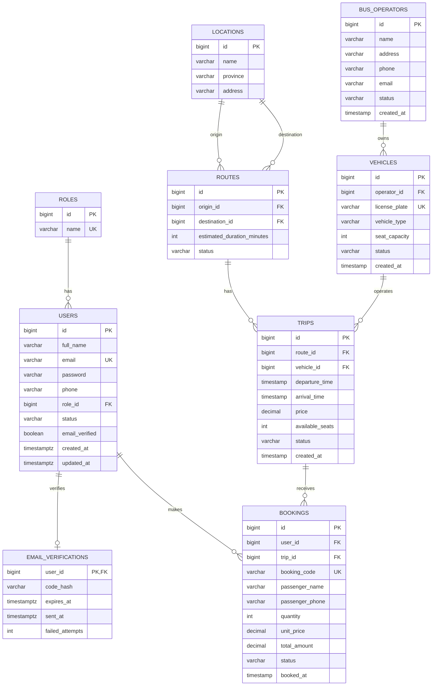

# 2. Thiết kế Database

**Hiện trạng repository:** V1–V11 tạo đầy đủ schema Role/User, Operator, Location, Vehicle, Route, Trip, Booking và email verification. V12 chuẩn hóa Location. V13 chuẩn hóa Bus Operator. V14 bảo đảm identity của Route. V15 chuẩn hóa Vehicle và thêm index cho quan hệ Operator–Vehicle–Trip. V16 hoãn bốn index thường của V14–V15 sang Pha 2, giữ nguyên toàn bộ ràng buộc toàn vẹn và UNIQUE index nghiệp vụ; xem [báo cáo rà soát index Pha 1](09-phase-one-index-review.md). Flyway migrations là nguồn sự thật của schema; các ghi chú phase cũ phía dưới chỉ có giá trị lịch sử.

## 2.1. Tổng quan Database

Hệ thống sử dụng cơ sở dữ liệu quan hệ để lưu trữ và quản lý thông tin người dùng, xác thực email, nhà xe, phương tiện, tuyến đường, chuyến xe và booking.

Database được thiết kế theo hướng chuẩn hóa dữ liệu, tách các thực thể có trách nhiệm khác nhau thành các bảng riêng biệt nhằm hạn chế dữ liệu trùng lặp và đảm bảo tính nhất quán. Đối với xác thực email, dữ liệu tài khoản nằm ở `users`, còn challenge OTP tạm thời nằm ở `email_verifications`; không lưu OTP gốc trong cơ sở dữ liệu.

Các thực thể chính của hệ thống gồm:

| Entity          | Mục đích                                      |
| --------------- | --------------------------------------------- |
| `roles`         | Lưu các vai trò của người dùng                |
| `users` | Lưu tài khoản, vai trò và trạng thái xác thực email |
| `email_verifications` | Lưu challenge OTP xác thực email của tài khoản |
| `bus_operators` | Lưu thông tin các nhà xe                      |
| `locations`     | Lưu các địa điểm được sử dụng làm điểm đi/đến |
| `vehicles`      | Lưu thông tin phương tiện                     |
| `routes`        | Lưu các tuyến đường                           |
| `trips`         | Lưu các chuyến xe cụ thể                      |
| `bookings`      | Lưu thông tin đặt vé                          |

---

## 2.2. ERD



---

## 2.3. Mô tả thực thể

### 2.3.1. `roles`

Lưu các vai trò được sử dụng để phân quyền người dùng.

| Column | Type        | Description |
| ------ | ----------- | ----------- |
| `id`   | BIGINT      | Khóa chính  |
| `name` | VARCHAR(30) | Tên vai trò |

Các giá trị đã sử dụng trên nhánh auth sau V11:

```text
USER
ADMIN
SUPER_ADMIN
```

`SUPER_ADMIN` được bổ sung qua V11; database ràng buộc tối đa một tài khoản có vai trò này.

---

### 2.3.2. `users`

Lưu thông tin tài khoản, quyền truy cập và trạng thái xác thực địa chỉ email của người dùng.

| Column | Type | Description |
| --- | --- | --- |
| `id` | BIGINT | Khóa chính |
| `full_name` | VARCHAR(100) | Họ và tên |
| `email` | VARCHAR(100) | Email đăng nhập, được chuẩn hóa và duy nhất |
| `password` | VARCHAR(255) | Hash mật khẩu, không lưu mật khẩu thô |
| `phone` | VARCHAR(20) | Số điện thoại |
| `role_id` | BIGINT | FK đến `roles` |
| `status` | VARCHAR(20) | Trạng thái ACTIVE/INACTIVE |
| `email_verified` | BOOLEAN | `NOT NULL DEFAULT FALSE`; đã xác minh email hay chưa |
| `created_at` | TIMESTAMP WITH TIME ZONE | Thời điểm tạo tài khoản |
| `updated_at` | TIMESTAMP WITH TIME ZONE | Thời điểm cập nhật tài khoản |

`email_verified` độc lập với `status`: tài khoản ACTIVE không có nghĩa email đã được xác minh. Cột này được bổ sung bằng migration V10; giá trị ban đầu của các tài khoản chưa xác minh là `FALSE`.

---

### 2.3.3. `bus_operators`

Lưu thông tin các nhà xe.

| Column       | Type         | Description   |
| ------------ | ------------ | ------------- |
| `id`         | BIGINT       | Khóa chính    |
| `name`       | VARCHAR(150) | Tên nhà xe    |
| `address`    | VARCHAR(255) | Địa chỉ       |
| `phone`      | VARCHAR(20)  | Số điện thoại |
| `email`      | VARCHAR(100) | Email         |
| `status`     | VARCHAR(20)  | Trạng thái    |
| `created_at` | TIMESTAMP    | Thời điểm tạo |

Từ V13, name/address được trim và gộp whitespace, email lưu lowercase, phone dùng dạng Việt Nam chuẩn hóa. Name và email có unique index riêng; migration dừng và rollback nếu dữ liệu cũ xung đột hoặc không hợp lệ, không tự thay đổi `vehicles.operator_id`.

---

### 2.3.4. `locations`

Lưu các địa điểm được sử dụng làm điểm đi hoặc điểm đến.

| Column     | Type         | Description    |
| ---------- | ------------ | -------------- |
| `id`       | BIGINT       | Khóa chính     |
| `name`     | VARCHAR(100) | Tên địa điểm   |
| `province` | VARCHAR(100) | Tỉnh/thành phố |
| `address`  | VARCHAR(255) | Địa chỉ        |

Từ V12, ba chuỗi phải ở dạng đã trim/gộp whitespace. Bộ ba `name`, `province`, `address` là duy nhất khi so sánh không phân biệt hoa/thường. Migration dừng và rollback nếu dữ liệu cũ xung đột; không tự xóa hoặc đổi khóa ngoại Route.

Ví dụ:

```text
Bến xe Mỹ Đình - Hà Nội
Bến xe Bãi Cháy - Quảng Ninh
Bến xe Việt Trì - Phú Thọ
```

---

### 2.3.5. `vehicles`

Lưu thông tin phương tiện thuộc các nhà xe.

| Column          | Type        | Description            |
| --------------- | ----------- | ---------------------- |
| `id`            | BIGINT      | Khóa chính             |
| `operator_id`   | BIGINT      | FK đến `bus_operators` |
| `license_plate` | VARCHAR(20) | Biển số xe             |
| `vehicle_type`  | VARCHAR(50) | Loại xe                |
| `seat_capacity` | INT         | Số ghế                 |
| `status`        | VARCHAR(20) | Trạng thái             |
| `created_at`    | TIMESTAMP   | Thời điểm tạo          |

Từ V15, biển số được uppercase và xóa whitespace; giá trị sau chuẩn hóa là duy nhất toàn hệ thống. `vehicle_type` được trim và gộp whitespace. Migration dừng và rollback nếu dữ liệu cũ tạo collision biển số, không tự gộp Vehicle vì Trip có thể đang tham chiếu.

---

### 2.3.6. `routes`

Lưu thông tin tuyến đường.

Một tuyến đường xác định điểm đi và điểm đến, ví dụ:

```text
Hà Nội → Hải Phòng
Hà Nội → Lạng Sơn
```

| Column                       | Type        | Description                 |
| ---------------------------- | ----------- | --------------------------- |
| `id`                         | BIGINT      | Khóa chính                  |
| `origin_id`                  | BIGINT      | FK đến `locations`          |
| `destination_id`             | BIGINT      | FK đến `locations`          |
| `estimated_duration_minutes` | INT         | Thời gian di chuyển dự kiến |
| `status`                     | VARCHAR(20) | Trạng thái tuyến            |

Từ V14, cặp có hướng `(origin_id, destination_id)` là duy nhất; tuyến chiều ngược lại là một Route khác. Migration dừng và rollback nếu dữ liệu cũ có cặp trùng, không tự gộp Route vì có thể làm thay đổi các Trip đang tham chiếu. Route đã có Trip không được thay đổi hai đầu tuyến ở tầng nghiệp vụ.

---

### 2.3.7. `trips`

Lưu thông tin của một chuyến xe cụ thể.

`routes` mô tả tuyến đường, trong khi `trips` mô tả một lần khởi hành cụ thể trên tuyến đó.

Ví dụ:

```text
Route:
Hà Nội → Hải Phòng
Trips:
06:00 - 10/10/2026
12:00 - 10/10/2026
20:00 - 10/10/2026
```

| Column            | Type          | Description           |
| ----------------- | ------------- | --------------------- |
| `id`              | BIGINT        | Khóa chính            |
| `route_id`        | BIGINT        | FK đến `routes`       |
| `vehicle_id`      | BIGINT        | FK đến `vehicles`     |
| `departure_time`  | TIMESTAMP     | Thời gian khởi hành   |
| `arrival_time`    | TIMESTAMP     | Thời gian dự kiến đến |
| `price`           | DECIMAL(12,2) | Giá vé                |
| `available_seats` | INT           | Số ghế còn trống      |
| `status`          | VARCHAR(20)   | Trạng thái chuyến     |
| `created_at`      | TIMESTAMP     | Thời điểm tạo         |

---

### 2.3.8. `bookings`

Lưu thông tin đặt vé của người dùng.

| Column            | Type          | Description                  |
| ----------------- | ------------- | ---------------------------- |
| `id`              | BIGINT        | Khóa chính                   |
| `user_id`         | BIGINT        | FK đến `users`               |
| `trip_id`         | BIGINT        | FK đến `trips`               |
| `booking_code`    | VARCHAR(30)   | Mã booking                   |
| `passenger_name`  | VARCHAR(100)  | Tên hành khách               |
| `passenger_phone` | VARCHAR(20)   | Số điện thoại hành khách     |
| `quantity`        | INT           | Số lượng vé                  |
| `unit_price`      | DECIMAL(12,2) | Giá một vé tại thời điểm đặt |
| `total_amount`    | DECIMAL(12,2) | Tổng tiền                    |
| `status`          | VARCHAR(30)   | Trạng thái booking           |
| `booked_at`       | TIMESTAMP     | Thời điểm đặt                |

Việc lưu `unit_price` và `total_amount` trong booking giúp giữ lại thông tin giá tại thời điểm đặt vé, thay vì phụ thuộc hoàn toàn vào giá hiện tại của chuyến xe.

---

### 2.3.9. `email_verifications`

Lưu challenge xác thực email bằng OTP cho người dùng chưa hoàn tất xác minh; đây là bảng đã triển khai ở migration V10.

| Column | Type | Description |
| --- | --- | --- |
| `user_id` | BIGINT | Khóa chính đồng thời là FK đến `users.id` (`ON DELETE CASCADE`) |
| `code_hash` | VARCHAR(64) | HMAC-SHA256 digest của email và OTP; không lưu mã OTP gốc |
| `expires_at` | TIMESTAMP WITH TIME ZONE | Thời điểm challenge hết hạn |
| `sent_at` | TIMESTAMP WITH TIME ZONE | Thời điểm gửi mã xác thực |
| `failed_attempts` | INT | Số lần nhập OTP không hợp lệ |

Mỗi người dùng có tối đa một challenge đang lưu trong bảng. Khi xác minh thành công, hệ thống xóa challenge và cập nhật `users.email_verified = TRUE` trong cùng transaction. Khi gửi lại mã, challenge được thay bằng digest, thời hạn mới và bộ đếm số lần nhập sai được đặt lại.

---

## 2.4. Quan hệ dữ liệu

### 2.4.1. Role – User

```text
ROLES 1 ───────── N USERS
```

Một role có thể được gán cho nhiều user.

Một user có một role.

---

### 2.4.2. Bus Operator – Vehicle

```text
BUS_OPERATORS 1 ───────── N VEHICLES
```

Một nhà xe có thể quản lý nhiều phương tiện.

Mỗi phương tiện thuộc về một nhà xe.

---

### 2.4.3. Location – Route

```text
LOCATIONS 1 ───────── N ROUTES
       │
       ├── origin
       │
       └── destination
```

Một địa điểm có thể được sử dụng làm điểm đi của nhiều tuyến và cũng có thể được sử dụng làm điểm đến của nhiều tuyến.

Mỗi route có một điểm đi và một điểm đến.

---

### 2.4.4. Route – Trip

```text
ROUTES 1 ───────── N TRIPS
```

Một tuyến đường có thể có nhiều chuyến xe.

Mỗi chuyến xe thuộc một tuyến đường.

---

### 2.4.5. Vehicle – Trip

```text
VEHICLES 1 ───────── N TRIPS
```

Một phương tiện có thể được sử dụng cho nhiều chuyến xe ở các thời điểm khác nhau.

Mỗi chuyến xe sử dụng một phương tiện.

---

### 2.4.6. User – Booking

```text
USERS 1 ───────── N BOOKINGS
```

Một người dùng có thể tạo nhiều booking.

Mỗi booking thuộc về một người dùng.

---

### 2.4.7. Trip – Booking

```text
TRIPS 1 ───────── N BOOKINGS
```

Một chuyến xe có thể có nhiều booking.

Mỗi booking thuộc về một chuyến xe.

---

### 2.4.8. User – Email Verification

```text
USERS 1 ───────── 0..1 EMAIL_VERIFICATIONS
```

Một người dùng có tối đa một challenge OTP đang lưu; mỗi challenge thuộc về đúng một người dùng. Quan hệ được ràng buộc bằng `email_verifications.user_id` vừa là khóa chính vừa là khóa ngoại đến `users.id`, với `ON DELETE CASCADE`.

---

## 2.5. Constraints

Database sử dụng các ràng buộc để đảm bảo tính toàn vẹn của dữ liệu.

### 2.5.1. Primary Key

Mỗi bảng có một khóa chính:

```text
roles.id
users.id
bus_operators.id
locations.id
vehicles.id
routes.id
trips.id
bookings.id
email_verifications.user_id
```

Khóa chính đảm bảo mỗi bản ghi được định danh duy nhất.

### 2.5.2. Foreign Key

Các khóa ngoại chính:

```text
users.role_id
    → roles.id
vehicles.operator_id
    → bus_operators.id
routes.origin_id
    → locations.id
routes.destination_id
    → locations.id
trips.route_id
    → routes.id
trips.vehicle_id
    → vehicles.id
bookings.user_id
    → users.id
bookings.trip_id
    → trips.id

email_verifications.user_id
    → users.id (ON DELETE CASCADE)
```

### 2.5.3. Unique Constraints

Các trường cần có giá trị duy nhất:

```text
roles.name
users.email
vehicles.license_plate
bookings.booking_code
```

Bổ sung từ V11: unique partial index `uk_users_single_super_admin` trên `users(role_id)` để bảo đảm tối đa một tài khoản có role `SUPER_ADMIN` (kể cả tài khoản INACTIVE).

### 2.5.4. Check Constraints

Một số điều kiện dữ liệu:

```text
vehicles.seat_capacity > 0
trips.price >= 0
trips.available_seats >= 0
bookings.quantity > 0
bookings.unit_price >= 0
bookings.total_amount >= 0
routes.origin_id <> routes.destination_id
```

Đối với xác thực email, `users.email_verified` có giá trị Boolean không null (mặc định `FALSE`), còn `email_verifications.failed_attempts` dùng để theo dõi số lần xác minh không thành công. Các giới hạn về hạn sử dụng OTP và số lần nhập sai được kiểm soát theo luồng nghiệp vụ xác thực.

### 2.5.5. Not Null

Các thông tin bắt buộc không được để trống, ví dụ:

```text
users.full_name
users.email
users.password
users.role_id
users.email_verified
email_verifications.user_id
email_verifications.code_hash
email_verifications.expires_at
email_verifications.sent_at
email_verifications.failed_attempts
vehicles.operator_id
vehicles.license_plate
vehicles.seat_capacity
routes.origin_id
routes.destination_id
trips.route_id
trips.vehicle_id
trips.departure_time
trips.price
bookings.user_id
bookings.trip_id
bookings.booking_code
bookings.quantity
```

### 2.5.6. Business-level Constraints

Một số quy tắc được kiểm tra ở tầng nghiệp vụ thay vì chỉ bằng database constraint:

* Không được đặt số lượng vé lớn hơn số ghế còn trống.

* User chỉ được xem và hủy booking của chính mình.

* Không được đặt vé cho chuyến xe đã bị hủy hoặc không còn hoạt động.

* Khi booking thành công, số ghế còn trống phải được cập nhật.

* Khi booking được hủy hợp lệ, số ghế phải được hoàn lại.
* OTP xác thực email có thời hạn sử dụng và số lần nhập sai cần được giới hạn theo chính sách nghiệp vụ.
* Xác minh đúng OTP phải cập nhật `users.email_verified` và xóa challenge một cách nguyên tử.
* Gửi lại OTP thay challenge cũ; không lưu mã OTP dưới dạng văn bản thuần.

Các quy tắc này thuộc nghiệp vụ và sẽ được xử lý tại Business Layer. Các quy tắc Trip/Booking hiện thuộc phần thiết kế, còn xác thực email đã được triển khai trên nhánh auth.

---

## 2.6. Indexes

Database sử dụng index cho các trường thường xuyên được sử dụng trong tìm kiếm hoặc truy vấn quan hệ.

### 2.6.1. User

```text
UNIQUE INDEX: users.email
```

Email được sử dụng khi đăng nhập và phải duy nhất. Email được chuẩn hóa trước khi lưu; cơ sở dữ liệu có ràng buộc duy nhất `uk_users_email`.

Đối với Email Verification, `email_verifications.user_id` là PK/FK nên đã được đánh chỉ mục duy nhất qua khóa chính, phục vụ tra cứu challenge theo người dùng. V11 bổ sung unique partial index `uk_users_single_super_admin` cho `users(role_id)` nhằm giới hạn vai trò SUPER_ADMIN. Không cần mặc định thêm một index riêng trên `email_verified` nếu chưa có truy vấn thường xuyên sử dụng trường này.

---

### 2.6.2. Vehicle

```text
UNIQUE INDEX: vehicles.license_plate
```

Biển số xe phải duy nhất trong hệ thống.

---

### 2.6.3. Booking

```text
UNIQUE INDEX: bookings.booking_code
```

Mã booking được sử dụng để xác định một booking.

Có thể bổ sung:

```text
INDEX: bookings.user_id
INDEX: bookings.trip_id
```

để hỗ trợ:

* Lấy lịch sử booking của một user.

* Lấy các booking của một chuyến xe.

---

### 2.6.4. Trip

Các trường thường được sử dụng khi tìm kiếm chuyến xe:

```text
INDEX: trips.route_id
INDEX: trips.departure_time
```

Có thể sử dụng composite index cho các truy vấn tìm chuyến theo tuyến và thời gian:

```text
INDEX: (route_id, departure_time)
```

---

### 2.6.5. Route

Các khóa ngoại:

```text
INDEX: routes.origin_id
INDEX: routes.destination_id
```

hỗ trợ tìm kiếm các tuyến theo điểm đi và điểm đến.

---

### 2.6.6. Nguyên tắc sử dụng Index

Index chỉ được tạo cho các trường có tần suất truy vấn phù hợp.

Trong Pha 1, hệ thống không thực hiện tối ưu hóa database ở mức phức tạp. Các index sẽ tập trung vào:

* Các trường `UNIQUE`.

* Các khóa ngoại thường xuyên được truy vấn.

* Các trường phục vụ chức năng tìm kiếm chuyến xe.

* Các trường phục vụ truy vấn booking của người dùng.

## 2.7. Quyết định triển khai Role/User ngày 1 (lịch sử, bổ sung ở 2.8/phase 4)

- Ghi chú lịch sử của nhánh auth từng dùng migration `V9__create_auth_roles_and_users.sql` và giữ V1–V8 rỗng. Trạng thái này không còn áp dụng cho repository hiện tại; schema thực tế được xác định bởi V1–V13 trong source.

- Tại thời điểm ngày 1, Role lưu USER/ADMIN, mỗi user có một role qua `role_id`; trạng thái user là ACTIVE/INACTIVE, default tại database là ACTIVE. Role SUPER_ADMIN được bổ sung về sau tại V11.

- Email được chuẩn hóa bằng strip/lowercase Locale.ROOT ở adapter/mapper; database yêu cầu `email = lower(btrim(email))`, khác rỗng và unique qua `uk_users_email`. Ghi SQL trực tiếp với email chưa chuẩn hóa bị từ chối.

- `phone` bắt buộc, tối đa 20 ký tự; `full_name` bắt buộc, tối đa 100 ký tự. Kiểm tra định dạng điện thoại và chính sách mật khẩu nằm ở bước triển khai đăng ký.

- Cột `password` chứa hash; domain/entity gọi thuộc tính là `passwordHash` để phân biệt với mật khẩu thô. Tầng data không tự hash; AuthService sẽ gọi PasswordHasher ở ngày tiếp theo.

- Riêng `users.created_at` và `users.updated_at` triển khai bằng `TIMESTAMP WITH TIME ZONE`, ánh xạ `Instant`; dữ liệu biểu diễn một thời điểm tuyệt đối, JDBC dùng UTC. Các mô tả TIMESTAMP của users phía trên được thay bằng quyết định này.

- PostgreSQL sở hữu timestamp: default khi insert, trigger khi update; trigger bảo toàn created_at và đặt updated_at bằng clock_timestamp(). Entity không ghi hai cột này; adapter refresh sau save để nhận giá trị database.

- Tại thời điểm ngày 1 chưa tạo admin hoặc cấp role qua API; đây là ghi nhận lịch sử, không phản ánh đầy đủ trạng thái sau phase 4. Khi tích hợp các nhánh, cần đối chiếu migration/schema và kiểu thời gian trước khi merge.

## 2.8. Bổ sung email verification phase 1

**Phạm vi thay đổi:** Migration `V10__add_email_verification.sql` bổ sung `users.email_verified BOOLEAN NOT NULL DEFAULT FALSE` và bảng `email_verifications`. Trạng thái ACTIVE/INACTIVE vẫn độc lập với xác minh email. Tài khoản tạo trước V10 không mặc nhiên được coi là đã xác minh; có thể yêu cầu gửi mã để tạo challenge đầu tiên.

**Lưu trữ challenge:** `email_verifications.user_id` là PK/FK (`ON DELETE CASCADE`), `code_hash VARCHAR(64)`, `expires_at` và `sent_at` là TIMESTAMPTZ, `failed_attempts` dùng đếm số lần nhập sai. HMAC-SHA256 được tính từ email kết hợp OTP bằng khóa riêng `EMAIL_OTP_SECRET`; **không lưu OTP thô**. Khóa OTP phải độc lập với khóa ký JWT.

**Luồng đăng ký và xác minh:** Đăng ký tạo user và challenge trong một transaction. Mã OTP được chuyển đến địa chỉ email qua SMTP sau khi transaction commit; xác minh đúng mã còn hiệu lực sẽ xóa challenge và cập nhật `users.email_verified = TRUE` trong cùng transaction. Việc gửi SMTP không nằm trong transaction database.

**Luồng xác minh sai / gửi lại:** Verify/resend khóa dòng user trước, sau đó đọc challenge bằng truy vấn riêng để tránh sử dụng snapshot cũ sau khi chờ khóa. Lần nhập sai cập nhật và commit bộ đếm trước khi service trả lỗi. Gửi lại mã thay digest, thiết lập lại thời hạn và reset `failed_attempts` trong transaction; OTP trước đó không còn là challenge hiện hành.

**Ranh giới dữ liệu và kiểm thử:** `users.email_verified` thể hiện kết quả đã xác minh; `email_verifications` chỉ lưu challenge đang được xử lý. Cần kiểm thử mã đúng, mã sai, mã hết hạn, gửi lại mã, xóa challenge sau khi xác minh và giới hạn số lần nhập sai. Tài liệu chi tiết luồng API và triển khai nằm ở `docs/07-auth-guide.md`.

## Cập nhật auth phase 4

Migration V11 thêm role SUPER_ADMIN bên cạnh USER/ADMIN và unique partial index uk_users_single_super_admin trên users(role_id), với predicate dùng ID SUPER_ADMIN thực tế đã seed. Tối đa một super admin, kể cả tài khoản inactive. Không seed tài khoản hoặc mật khẩu trong migration. API chỉ cho SUPER_ADMIN nâng/hạ USER ↔ ADMIN; xem docs/07-auth-guide.md.
