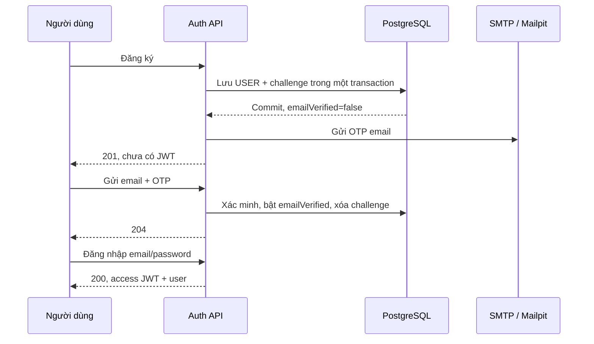

# Auth — Chức năng, API và hướng dẫn sử dụng

Người phụ trách: **Nguyễn Văn Huy Hoàng**. Nhánh: `feature/hoang`.

Tài liệu này thay thế toàn bộ kế hoạch và báo cáo docs 07–19 trước đây, mô tả trạng thái Auth hiện hành sau nghiệm thu độc lập ngày 22/10/2026. Phần tích hợp Trip/Booking thật của Huy vẫn đang chờ; các quyền trên route nghiệp vụ chưa có controller được kiểm chứng bằng fixture trong test.

## 1. Các chức năng chính

| Chức năng | Hành vi đã triển khai |
| --- | --- |
| Đăng ký | Tạo USER/ACTIVE, lưu mật khẩu BCrypt, gửi OTP email; chưa cấp JWT |
| Xác minh email | OTP 6 số, hạn 10 phút, tối đa 5 lần sai; xác minh thành công mới được login |
| Gửi lại OTP | Cooldown 60 giây; mã mới thay mã cũ, reset số lần sai |
| Đăng nhập | Email/password hợp lệ, tài khoản ACTIVE và đã xác minh email → access JWT |
| Danh tính hiện tại | Đọc tài khoản theo principal từ JWT và database, không theo ID client gửi thêm |
| Cập nhật profile | Chỉ sửa họ tên và số điện thoại Việt Nam |
| Phân quyền | USER, ADMIN, SUPER_ADMIN; quyền được đọc lại mỗi request |
| Super admin đầu tiên | Bootstrap opt-in dev/test, tối đa một tài khoản, vẫn phải OTP email |
| Quản lý role | Chỉ SUPER_ADMIN nâng/hạ USER ↔ ADMIN; ADMIN thường không được quản lý role |
| Bảo vệ API | Stateless, JSON lỗi chung, rate limit, CORS allowlist, Swagger bearerAuth |

Điện thoại chỉ dùng liên hệ, không xác minh bằng SMS. Nhân viên là USER đã đăng ký; không có role STAFF.

## 2. Tài khoản và quy tắc đầu vào

- **Email:** strip khoảng trắng đầu/cuối, lowercase bằng Locale.ROOT; tối đa 100 ký tự, local-part tối đa 64. Chấp nhận định dạng ASCII có domain, không hỗ trợ toàn bộ cú pháp RFC hoặc email Unicode. Database chặn email chưa chuẩn hóa và email trùng.
- **Password đăng ký:** ít nhất 8 Unicode code point, tối đa 72 byte UTF-8, không toàn khoảng trắng; không trim/lowercase hoặc cắt ngắn ngầm. BCrypt cost 10, mỗi hash có salt riêng. Login không áp lại độ dài tối thiểu của đăng ký. Email không tồn tại vẫn đối chiếu dummy hash để giảm khác biệt thời gian.
- **fullName:** strip, bắt buộc, tối đa 100 ký tự, không ký tự điều khiển.
- **phone:** mobile 10 số bắt đầu 03/05/07/08/09 hoặc cố định 11 số bắt đầu 02. Nhận +84 và chuẩn hóa về 0; không nhận dấu phân cách ở giữa. Chỉ kiểm tra định dạng, không chứng minh quyền sở hữu.
- **Trạng thái:** ACTIVE/INACTIVE độc lập với emailVerified. Đăng ký tạo ACTIVE/emailVerified=false; phải ACTIVE và verified mới login hoặc dùng JWT được.
- **Field đặc quyền:** register/profile không nhận id, role, status, emailVerified hoặc passwordHash. DTO từ chối field không hỗ trợ bằng 400.

Email không tồn tại, sai password, INACTIVE hoặc chưa xác minh đều dùng phản hồi đăng nhập chung. Lỗi database/hạ tầng không bị chuyển thành sai mật khẩu.

## 3. Luồng đăng ký, OTP và đăng nhập



OTP được sinh ngẫu nhiên bằng SecureRandom. Database chỉ lưu HMAC-SHA256 của email + mã, với EMAIL_OTP_SECRET riêng; không lưu OTP thô. Xác minh đúng cập nhật verified và xóa challenge trong cùng transaction, mã đã dùng không dùng lại được.

Verify/resend khóa user trước, rồi đọc challenge bằng câu lệnh riêng để tránh snapshot cũ khi có request đồng thời. Verify lấy thời gian hiện tại từ Clock **sau khi lấy được khóa**, nên OTP hết hạn trong lúc chờ khóa sẽ bị từ chối. Lần nhập sai được commit trước khi trả lỗi; resend thay digest, thời hạn và attempts nguyên tử.

SMTP gửi **sau commit**. Nếu gửi thất bại, API trả 503 nhưng tài khoản pending vẫn tồn tại và chưa thể login; phục hồi bằng resend sau cooldown, không đăng ký lại cùng email. Chưa có outbox/worker tự retry.

Resend trả thông báo chung nếu tài khoản không tồn tại, inactive hoặc đã verified; tài khoản pending gọi quá sớm nhận 429. User cũ chưa có challenge có thể yêu cầu mã đầu tiên. Challenge hết hạn được thay khi resend hoặc xóa khi verify thành công/user bị xóa; chưa có job dọn tài khoản pending cũ.

## 4. Danh sách API đã triển khai

Base URL local: **http://localhost:8085**. Request/response JSON; endpoint bảo vệ dùng `Authorization: Bearer <JWT>`.

| Method | Path | Quyền | Thành công |
| --- | --- | --- | --- |
| POST | /api/auth/register | Public | 201 UserResponse |
| POST | /api/auth/verify-email | Public | 204, không body |
| POST | /api/auth/resend-verification | Public | 202 MessageResponse |
| POST | /api/auth/login | Public | 200 LoginResponse |
| GET | /api/auth/me | USER/ADMIN/SUPER_ADMIN | 200 CurrentUserResponse |
| GET | /api/users/me | USER/ADMIN/SUPER_ADMIN | 200 UserResponse |
| PUT | /api/users/me | USER/ADMIN/SUPER_ADMIN | 200 UserResponse |
| PUT | /api/admin/users/{userId}/role | Chỉ SUPER_ADMIN | 200 UserResponse |

Các response auth/profile/role đặt Cache-Control: no-store. Public endpoint không cần token, nhưng nếu gửi Bearer sai thì vẫn nhận 401; request vượt quota có thể bị 429 trước khi kiểm tra JWT/body.

### 4.1. Đăng ký và xác minh

POST `/api/auth/register`:

```json
{
  "fullName": "Nguyễn Văn Huy Hoàng",
  "email": "hoang.demo@example.com",
  "password": "DemoPassword123!",
  "phone": "0901234567"
}
```

Response 201:

```json
{
  "id": 1,
  "fullName": "Nguyễn Văn Huy Hoàng",
  "email": "hoang.demo@example.com",
  "phone": "0901234567",
  "role": "USER",
  "emailVerified": false
}
```

POST `/api/auth/verify-email` với `{"email":"hoang.demo@example.com","code":"012345"}`. Code phải là chuỗi để giữ số 0 đầu; thành công 204, không cấp JWT.

POST `/api/auth/resend-verification` với `{"email":"hoang.demo@example.com"}`. Thành công 202:

```json
{"message":"If the account is eligible, a verification email has been sent"}
```

### 4.2. Đăng nhập và đọc tài khoản

POST `/api/auth/login`:

```json
{"email":"hoang.demo@example.com","password":"DemoPassword123!"}
```

Response 200 có dạng:

```json
{
  "token": "REPLACE_WITH_ACCESS_JWT",
  "tokenType": "Bearer",
  "expiresIn": 86400,
  "user": {
    "id": 1,
    "fullName": "Nguyễn Văn Huy Hoàng",
    "email": "hoang.demo@example.com",
    "phone": "0901234567",
    "role": "USER",
    "emailVerified": true
  }
}
```

expiresIn tính bằng **giây**, theo TTL đã cấu hình. GET `/api/auth/me` và `/api/users/me` trả các trường user như trên, không trả token hoặc hash. ID đến từ principal; query/body client không được chọn tài khoản khác.

### 4.3. Cập nhật profile

PUT `/api/users/me` yêu cầu cả hai trường:

```json
{"fullName":"Hoàng Updated","phone":"+84912345678"}
```

Response 200 chuẩn hóa phone thành `0912345678`. Chỉ sửa full_name/phone; giữ email/hash/role/status/emailVerified/createdAt. Câu update có điều kiện ACTIVE + verified, tránh ghi đè thuộc tính bảo mật từ snapshot cũ. Database cập nhật updated_at. Hai update profile đồng thời dùng last-write-wins, chưa có ETag/version.

### 4.4. Nâng/hạ quyền nhân viên

SUPER_ADMIN gọi PUT `/api/admin/users/{userId}/role`:

```json
{"role":"ADMIN"}
```

Muốn thu hồi gửi `{"role":"USER"}`. Role phải là tên enum, không nhận số thứ tự: `0`, `1`, `"0"`, `"1"` đều trả 400 và không đổi quyền. Jackson 3 được cấu hình `spring.jackson.datatype.enum.fail-on-numbers-for-enums=true`. Lấy userId từ response đăng ký/profile của nhân viên.

- Chỉ nâng ADMIN khi target ACTIVE và verified; không đủ điều kiện trả 409 ACCOUNT_NOT_ELIGIBLE.
- Cho hạ ADMIN về USER kể cả inactive/chưa verified để thu hồi quyền.
- Không tìm thấy target → 404; target là SUPER_ADMIN → 403; gán role SUPER_ADMIN → 400.
- USER/ADMIN thường gọi endpoint → 403. Không có API tạo, thay thế hoặc hạ SUPER_ADMIN.
- Adapter khóa actor rồi target và kiểm tra lại điều kiện trong transaction. Quyền mới áp dụng ở request tiếp theo với JWT hiện tại.

## 5. JWT, phân quyền và bảo vệ request

JWT ký HS256, chỉ chứa sub=userId, iat, exp, iss; không chứa email, role, password hoặc trạng thái. Key Base64 ít nhất 32 byte giải mã, TTL mặc định 86400000 ms (24 giờ), phải dương và bội số 1000; issuer mặc định busbooking. Cấu hình sai làm startup thất bại.

Parser kiểm tra thuật toán/chữ ký/issuer/claims bắt buộc, userId dương hợp lệ, iat không tương lai và exp còn hiệu lực. Mỗi request hợp lệ tải lại user/role từ database: user bị xóa, inactive hoặc thu hồi verified bị chặn; đổi role/email có hiệu lực ở request sau.

Security chain stateless, không session/cookie xác thực; tắt HTTP Basic, form login, logout mặc định và request cache. Đã loại Boot fallback in-memory user/generated password. CSRF tắt theo thiết kế Bearer header; cần đánh giá lại nếu đổi sang cookie. Filter chạy đúng một lần, dọn SecurityContext sau request; lỗi hạ tầng trả 500, không giả thành 401.

| Route | Rule hiện tại |
| --- | --- |
| Bốn POST auth công khai | Public đúng method/path; auth/me được bảo vệ |
| GET auth/me, GET/PUT users/me | USER/ADMIN/SUPER_ADMIN |
| PUT admin/users/{userId}/role | Chỉ SUPER_ADMIN |
| /api/admin/** còn lại | ADMIN/SUPER_ADMIN |
| GET /api/trips, /api/trips/{id} | Public theo rule; chưa có controller nghiệp vụ thật |
| GET /api/users/me/bookings; POST /api/bookings | Chỉ USER theo contract hiện tại |
| GET/DELETE /api/bookings/{id} | USER/ADMIN/SUPER_ADMIN; cần ownership tại business khi tích hợp |
| Swagger/OpenAPI | Public khi docs bật; dev/test bật mặc định |
| Route/method khác | denyAll |

SUPER_ADMIN dùng chức năng quản trị ADMIN; không có role hierarchy tự động mở các API chỉ dành USER. Rule security không chứng minh CRUD hay ownership đã được triển khai.

CORS chỉ cho origin chính xác từ CORS_ALLOWED_ORIGINS, không wildcard/credentials. Mặc định danh sách rỗng. Không tin Forwarded/X-Forwarded-For; server.forward-headers-strategy=none, proxy thật cần cấu hình trusted proxy riêng.

## 6. Rate limit và JSON lỗi

Theo mỗi IP kết nối + endpoint, cửa sổ mặc định 60 giây:

| POST endpoint | Request/cửa sổ |
| --- | --- |
| register | 5 |
| login | 10 |
| verify-email | 20 |
| resend-verification | 5 |

Tính cả request lỗi/JSON hỏng, không đọc mất request body. Limiter thread-safe, in-memory, tối đa 10000 key mặc định; cleanup key hết hạn và từ chối có kiểm soát khi hết capacity. Quota reset khi restart, không chia sẻ nhiều instance. Giới hạn OTP theo tài khoản vẫn áp dụng độc lập.

Lỗi có timestamp/status/error/message/path và details tùy chọn, không đưa SQL/stack trace/giá trị nhạy cảm vào response:

```json
{
  "timestamp": "2026-10-22T00:00:00Z",
  "status": 409,
  "error": "EMAIL_ALREADY_EXISTS",
  "message": "Email is already registered",
  "path": "/api/auth/register"
}
```

| HTTP | Mã lỗi chính |
| --- | --- |
| 400 | VALIDATION_ERROR, INVALID_REQUEST, INVALID_VERIFICATION_CODE |
| 401 | UNAUTHORIZED; có WWW-Authenticate: Bearer |
| 403 | FORBIDDEN |
| 404 | NOT_FOUND, ví dụ target role không tồn tại |
| 405 / 415 | METHOD_NOT_ALLOWED / UNSUPPORTED_MEDIA_TYPE |
| 409 | EMAIL_ALREADY_EXISTS, ACCOUNT_NOT_ELIGIBLE |
| 429 | RATE_LIMITED; có Retry-After |
| 500 | INTERNAL_ERROR |
| 503 | EMAIL_DELIVERY_UNAVAILABLE |

Cooldown OTP trả Retry-After=60 bảo thủ, không phải số giây còn lại chính xác. Route lạ có thể bị security trả 401/403 trước MVC; không cam kết mọi URI lạ đều 404. Error dispatch nội bộ giữ status gốc; `/error` không public cho request thường.

## 7. Super admin đầu tiên

Database bảo đảm **tối đa một SUPER_ADMIN**, kể cả super hiện tại inactive. Không seed tài khoản/password trong migration. Bootstrap mặc định tắt, chỉ cho explicit profile dev/test; profile khác hoặc ghép prod bị từ chối.

Trong Bash, đặt cấu hình trước khi chạy dev:

```bash
export BOOTSTRAP_SUPER_ADMIN_ENABLED=true
export BOOTSTRAP_SUPER_ADMIN_EMAIL=hoang@example.com
export BOOTSTRAP_SUPER_ADMIN_FULL_NAME='Nguyễn Văn Huy Hoàng'
export BOOTSTRAP_SUPER_ADMIN_PHONE=0901234567
read -rsp 'Super admin password: ' BOOTSTRAP_SUPER_ADMIN_PASSWORD
export BOOTSTRAP_SUPER_ADMIN_PASSWORD
bash mvnw spring-boot:run -Dspring-boot.run.profiles=dev
```

Dùng email của bạn khi gửi SMTP thật. Nhận OTP qua email/Mailpit, gọi verify-email rồi login như USER. Sau khởi tạo, tắt flag và bỏ password bootstrap khỏi môi trường cho lần chạy sau:

```bash
export BOOTSTRAP_SUPER_ADMIN_ENABLED=false
unset BOOTSTRAP_SUPER_ADMIN_PASSWORD
```

Cùng email super đã tồn tại: không reset password/profile/status/verification, không gửi lại OTP mỗi restart. Email đã là USER/ADMIN hoặc super email khác: từ chối, không tự promote/thay thế. Chạy đồng thời dựa unique constraint để chỉ tạo một super. SMTP lỗi giữ account pending, cho dùng resend phục hồi. Chưa có công cụ provision/khôi phục super production.

## 8. Kiến trúc và database

Luồng phụ thuộc: **API → business/ports → adapter/data → PostgreSQL**. Business/domain Java thuần, không phụ thuộc HTTP/JPA/JJWT. Wiring bean ở config; transaction ở adapter/hạ tầng.

| Thành phần | Trách nhiệm |
| --- | --- |
| AuthController / AuthService | Register/login/current user |
| EmailVerificationService / SMTP sender | OTP, resend, gửi mail sau commit |
| UserController / UserService | Profile theo principal, update giới hạn |
| RoleManagementController / Service / Adapter | Nâng/hạ USER ↔ ADMIN, kiểm tra quyền và khóa transaction |
| BootstrapSuperAdminService / UserConfig | Tạo super đầu tiên opt-in, idempotent |
| JwtService / CurrentUserLoader / JwtAuthenticationFilter | Cấp/verify token, tải danh tính hiện tại |
| SecurityConfig / limiter / error handlers | Chain, role/method/path, rate limit, JSON lỗi |
| Persistence mapper / repository adapter | Domain ↔ JPA, tải role trong transaction với open-in-view=false |

| Migration | Nội dung |
| --- | --- |
| V1–V8 | Rỗng, giữ lịch sử/checksum |
| V9 | roles/users, seed USER/ADMIN, unique email/FK/CHECK, trigger timestamp |
| V10 | users.email_verified và bảng email_verifications |
| V11 | Seed SUPER_ADMIN, partial unique index uk_users_single_super_admin theo ID role thực tế |

users có id/full_name/email/password(hash)/phone/role_id/status/email_verified/created_at/updated_at. email_verifications có user_id PK/FK ON DELETE CASCADE, code_hash, expires_at, sent_at, failed_attempts. Timestamps TIMESTAMPTZ ánh xạ Instant, JDBC UTC; PostgreSQL sở hữu created_at/updated_at.

Chỉ unique violation SQLState 23505 đúng uk_users_email mới chuyển DuplicateEmailException; FK/CHECK không bị coi là email trùng. Unique constraint quyết định cuối khi đăng ký đồng thời. Hibernate ddl-auto=validate; Flyway quản lý schema, không sửa checksum migration đã dùng để che xung đột khi tích hợp.

## 9. Cấu hình và chạy local

Cần **JDK 21 đầy đủ** (java + javac), Maven Wrapper, PostgreSQL 15+ và database test riêng. Kiểm tra:

```bash
java -version
javac -version
bash mvnw -v
```

Nếu có nhiều Java, chọn JAVA_HOME/IDE/Maven runner đúng JDK 21. Không dựa vào JDK tạm trong /tmp cho môi trường lâu dài.

Tạo database và user có quyền chạy migration, rồi cấu hình Bash:

```bash
export DB_URL=jdbc:postgresql://localhost:5433/busbooking
export DB_USERNAME=busbooking_user
read -rsp 'Database password: ' DB_PASSWORD
export DB_PASSWORD
export JWT_SECRET="$(openssl rand -base64 32)"
export EMAIL_OTP_SECRET="$(openssl rand -base64 32)"
export JWT_EXPIRATION_MS=86400000
export JWT_ISSUER=busbooking
export SMTP_HOST=127.0.0.1
export SMTP_PORT=1025
export SMTP_AUTH=false
export SMTP_STARTTLS=false
export SMTP_FROM=noreply@example.com
export BOOTSTRAP_SUPER_ADMIN_ENABLED=false
```

Hai key độc lập, giữ ổn định qua restart nếu cần token/challenge còn hiệu lực. `.env.example` là mẫu; Spring Boot không tự nạp `.env`. Không commit secret thật.

Mailpit local (nếu chưa có dịch vụ tương ứng):

```bash
docker run -d --name busbooking-auth-mailpit \
  -p 127.0.0.1:1025:1025 -p 127.0.0.1:8025:8025 \
  axllent/mailpit:v1.27.8
```

Mailpit UI: http://localhost:8025. SMTP thật dùng SMTP_USERNAME/SMTP_PASSWORD, SMTP_AUTH=true và SMTP_STARTTLS=true theo nhà cung cấp; không gửi password/API key trong chat. Timeout SMTP mặc định 5 giây.

```bash
bash mvnw spring-boot:run -Dspring-boot.run.profiles=dev
```

Ứng dụng: http://localhost:8085. Swagger: http://localhost:8085/swagger-ui/index.html; OpenAPI: http://localhost:8085/v3/api-docs. PowerShell dùng `mvnw.cmd` và cú pháp đặt biến tương ứng.

Các nhóm cấu hình khác trong [.env.example](../.env.example): API_DOCS_ENABLED (ngoài dev/test mặc định false), CORS_ALLOWED_ORIGINS, AUTH_RATE_WINDOW_SECONDS/MAX_KEYS và REGISTER_LIMIT/LOGIN_LIMIT/VERIFY_LIMIT/RESEND_LIMIT với prefix AUTH_RATE_. Profile test dùng TEST_DB_URL/USERNAME/PASSWORD, bootstrap off và key cố định chỉ dành test.

## 10. Demo và kiểm thử

### 10.1. Demo chức năng

Dùng [auth.http](../requests/auth.http), [profile.http](../requests/profile.http), [super-admin.http](../requests/super-admin.http). Các file dùng cổng 8085; chỉnh placeholder local, không commit token/OTP/credential thật.

1. Register email mới → 201 USER/verified=false; login lúc này → 401.
2. Lấy OTP Mailpit → verify 204 → login 200, lưu JWT local.
3. GET auth/me và users/me → cùng tài khoản; PUT profile → tên/phone mới, GET auth/me phản ánh thay đổi.
4. Gửi role/status/id vào profile → 400; USER vào route admin → 403.
5. Bootstrap super theo mục 7 → OTP → login. Nhân viên USER đăng ký và verify; super nâng ADMIN → profile với JWT nhân viên cũ thấy ADMIN.
6. ADMIN thường quản lý role → 403; super hạ USER → JWT cũ phản ánh quyền mới. Không thể cấp/hạ SUPER_ADMIN qua HTTP.

### 10.2. Chạy test và JAR

```bash
export TEST_DB_URL=jdbc:postgresql://localhost:55433/busbooking_test
export TEST_DB_USERNAME=busbooking_test
read -rsp 'Test database password: ' TEST_DB_PASSWORD
export TEST_DB_PASSWORD
bash mvnw -B clean verify
# Cần thêm SMTP/Mailpit local; chạy tuần tự, không song song các suite chung database:
bash mvnw -B -Dtest=AuthLiveHttpSmokeIT,SuperAdminLiveHttpSmokeIT,SmtpMailpitSmokeIT test
```

Test mặc định không cần SMTP thật; smoke *IT chỉ chạy khi chỉ định. Có thể chạy toàn bộ bằng `bash mvnw -B '-Dtest=*Test,*Tests,*IT' clean verify`. SMTP smoke dùng địa chỉ người nhận UUID riêng từng lần, chỉ kiểm tra OTP trong đúng email đó và cố định SMTP local 127.0.0.1:1025 để tránh dùng mail cũ làm bằng chứng. Chỉ dùng database test riêng, không dùng database có super admin thật cho bootstrap tests. Smoke phase 4 cố định SMTP host 127.0.0.1; smoke phase 3 dùng spring.mail.host, cần kiểm tra SMTP_HOST local.

Nghiệm thu migration từ đầu bằng **database mới** và TEST_DB_URL tương ứng; không drop database có dữ liệu. Log cần đủ 11 migration lên v11, Hibernate validate thành công. Sau verify:

```bash
java -jar target/busbooking-0.0.1-SNAPSHOT.jar --spring.profiles.active=dev
```

JAR dùng DB_* và key như mục 9, không dùng TEST_DB_*; dừng bằng Ctrl+C sau kiểm tra.

### 10.3. Bằng chứng nghiệm thu gần nhất

Ngày 22/10/2026: JDK 21.0.12.1, Maven 3.9.16, PostgreSQL 15.19, database test riêng và Mailpit local.

- Sau sửa ba điểm review, chạy `bash mvnw -B '-Dtest=*Test,*Tests,*IT' clean verify`: **151 test, 0 failure/error/skipped — BUILD SUCCESS**, gồm **148 test mặc định và 3 smoke opt-in**; đã đóng gói executable JAR.
- Hai test hồi quy mới: `rejectsOtpThatExpiresWhileVerificationWaitsForTheAccountLock` giữ row lock thật, quan sát worker chờ khóa rồi tăng fake Clock đến expiry trước khi mở khóa; `numericRoleValuesAre400AndNeverChangeTheTargetRole` kiểm tra số/chuỗi số trả 400, quyền không thay đổi và tên role hợp lệ vẫn dùng được.
- SMTP smoke dùng recipient UUID mới, kiểm tra đúng To/Snippet của email đó và pin SMTP loopback. Ba smoke gồm USER HTTP/SMTP, SUPER_ADMIN/nhân viên HTTP/SMTP và gửi SMTP trực tiếp.
- Bộ test còn bao gồm đăng ký đồng thời một 201/một 409, OTP race/hết hạn/5 lần sai/resend, SMTP failure và phục hồi, token sau khóa/xóa/đổi role, chống nâng quyền profile, bootstrap đồng thời và unique super, limiter/CORS/JSON lỗi/OpenAPI.
- Bằng chứng database sạch ở đợt nghiệm thu trước: Flyway áp dụng V1–V11, Hibernate validate; JAR dev chạy thật, auth/me không token hoặc Basic → 401, /login → 401, OpenAPI → 200, không generated security password. Process và database nghiệm thu tạm đã được dọn; database/container test cũ được giữ. Lần sửa review không thay migration.
- `git diff --check` pass. Chưa commit hoặc push trong đợt sửa review.

## 11. Contract bàn giao và phần còn lại

Controller nghiệp vụ nhận `AuthenticatedPrincipal(Long userId, String email, RoleName role)` bằng @AuthenticationPrincipal. Không tin ID/role trong payload client; không trả entity/UserDetails chứa hash. Dùng ErrorResponse/handler chung, Swagger bearerAuth và repository port, tránh thêm security chain/filter trùng.

**Auth độc lập đã hoàn tất. Tích hợp Huy chưa nghiệm thu:**

- Review code được yêu cầu tích hợp, đối chiếu migration version/name/checksum, schema và kiểu thời gian.
- Kiểm tra public Trip GET và Booking trên controller/business thật.
- BookingService lấy actor từ principal; USER A không đọc/hủy booking USER B. Chốt quyền quản trị booking nếu contract chưa rõ trước khi sửa business.
- Chạy hồi quy auth + nghiệp vụ sau ghép. Fixture security không thay thế ownership test thật.

Chưa triển khai refresh token, logout thu hồi access token phía server, đổi/quên mật khẩu, OAuth/MFA; hết hạn token phải login lại. Chưa có CRUD nghiệp vụ hoặc danh sách nhân viên trong phần auth này. Limiter in-memory, profile last-write-wins và bootstrap chỉ dev/test là giới hạn hiện tại.

Nếu mật khẩu database từng hardcode đã được dùng thật, quản trị viên cần đổi credential ở hệ thống đó; repository không xác nhận được việc này. Không tự merge nhánh huy, commit hoặc push từ việc có hướng dẫn bàn giao.
