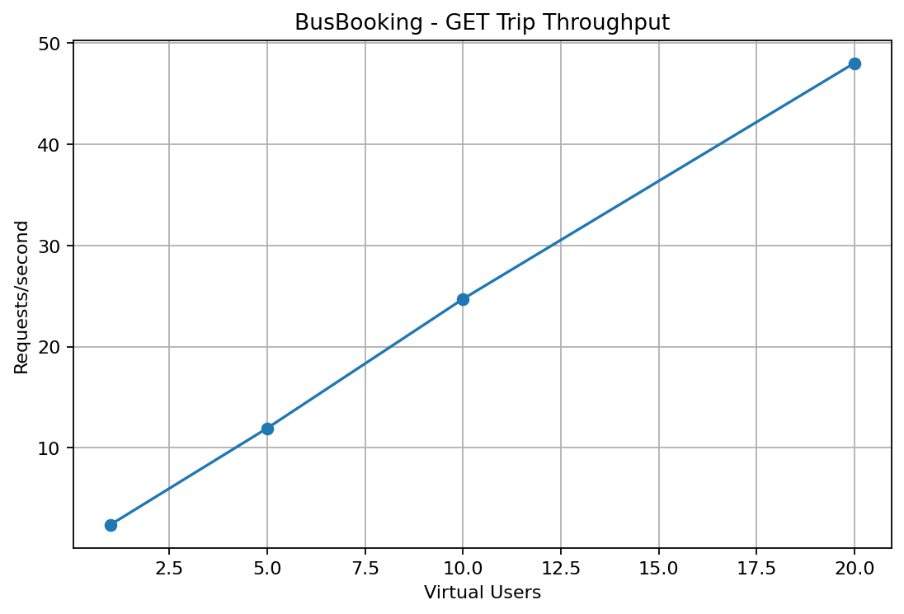
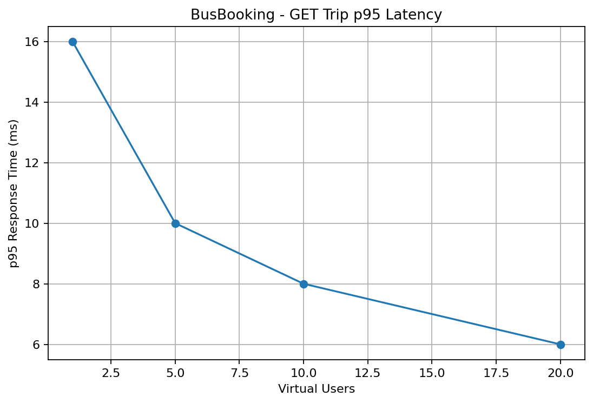
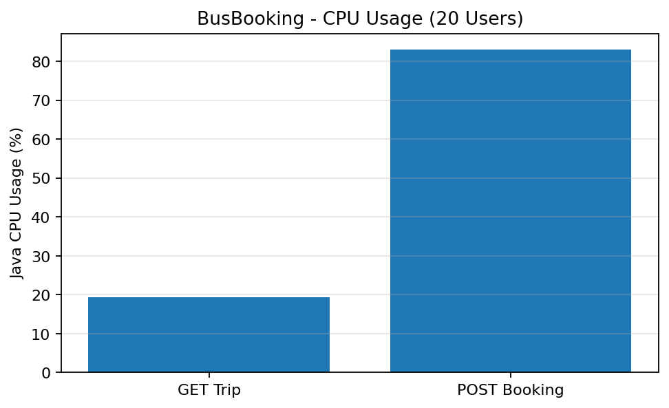
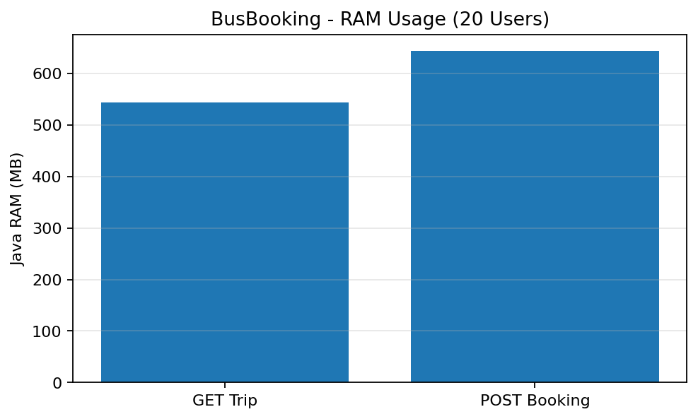

# BusBooking — Kết quả kiểm thử tải Pha 1

**Ngày kiểm thử:** 27/10/2026  
**Môi trường:** Kaggle Notebook - CPU, không sử dụng GPU  
**Hệ thống:** BusBooking (Java/Spring Boot, PostgreSQL)  
**Công cụ:** Locust (Python), `psutil`  
**Mục đích:** ghi nhận hiệu năng gốc (*baseline*) để nhóm Pha 2 đối chiếu sau khi cải tiến kiến trúc.

> Đây là kết quả các lượt kiểm thử đã thực hiện, không phải giới hạn chịu tải tối đa hay cam kết hiệu năng. Xem [hướng dẫn chạy kiểm thử tải](./scripts/load_testing.md) để tái lập.

## 1. Thiết lập kiểm thử

| Hạng mục | Thiết lập |
|---|---|
| Máy chạy | Một phiên Kaggle CPU; backend, PostgreSQL và Locust dùng chung tài nguyên |
| Backend | Spring Boot chạy từ JAR trên Kaggle |
| Database | PostgreSQL riêng trên Kaggle; dữ liệu giả lập |
| Workload đọc | `GET /api/trips` (75%) và `GET /api/trips/{id}` (25%) |
| Tải GET | 1, 5, 10, 20 virtual users; 60 giây mỗi mức |
| Workload ghi | `POST /api/bookings`, đặt một vé/request với JWT của một USER test |
| Tải POST chính thức | 20 virtual users; 60 giây; 1.000 Trip mới, mỗi Trip 4 ghế |
| Ramp-up | Tối đa 5 users/giây |
| Wait time | Ngẫu nhiên 0,2–0,6 giây giữa các request |
| Theo dõi tài nguyên | `psutil`, CPU trung bình và RAM RSS cao nhất **của tiến trình Java** |

Model CPU cụ thể, số CPU logic, phiên bản JAR và phần mềm cần đối chiếu trong [`manifest.json`](results/busbooking_baseline/manifest.json). Các giá trị đó chưa được xác minh trong tài liệu tổng hợp này.

## 2. Kết quả GET Trip

| Users | Requests | Failures | RPS | Avg (ms) | p50 (ms) | p95 (ms) | p99 (ms) | Java CPU TB | Java RAM tối đa |
|---:|---:|---:|---:|---:|---:|---:|---:|---:|---:|
| 1 | 143 | 0 | 2,42 | 9,08 | 8 | 12 | 16 | 4,21% | 519,90 MB |
| 5 | 731 | 0 | 12,40 | 6,43 | 6 | 8 | 11 | 10,69% | 530,87 MB |
| 10 | 1.448 | 0 | 24,52 | 4,74 | 5 | 6 | 7 | 14,40% | 540,65 MB |
| 20 | 2.825 | 0 | 47,83 | 4,06 | 4 | 5 | 6 | 14,55% | 541,50 MB |

**Tổng GET: 5.147 request, 0 lỗi Locust.** Thông lượng tăng khi số người dùng ảo tăng trong khoảng 1–20. Độ trễ giảm ở các lượt đo sau có thể liên quan đến JVM warm-up/JIT và cache; không suy ra rằng nhiều người dùng hơn làm hệ thống nhanh hơn.

### Biểu đồ GET

## 3. Kết quả POST Booking

### 3.1. Lượt kiểm tra giới hạn ghế

Kịch bản ban đầu dùng **200 Trip × 4 ghế = 800 ghế**:

| Requests | Booking thành công | HTTP 409 | Ghế còn lại |
|---:|---:|---:|---:|
| 2.832 | 800 | 2.032 | 0 |

Sau thử nghiệm, cả 200 Trip đều hết ghế. HTTP 409 là phản hồi từ chối đặt thêm khi không còn chỗ, **không nên tính như sự cố hạ tầng** và lượt này **không dùng làm baseline throughput POST chính thức**.

### 3.2. Lượt benchmark POST chính thức

Đã tạo bộ fixture mới với **1.000 Trip × 4 ghế = 4.000 ghế**. Locust phân phối tối đa bốn yêu cầu đặt một vé tới mỗi Trip.

| Users | Thời gian | Requests | Failures | RPS | Avg (ms) | p50 (ms) | p95 (ms) | p99 (ms) | Java CPU TB | Java RAM tối đa |
|---:|---:|---:|---:|---:|---:|---:|---:|---:|---:|---:|
| 20 | 60s | **2.767** | **0** | **46,84** | **13,42** | 13 | **18** | 23 | **33,71%** | **660,44 MB** |

**Kiểm tra tính nhất quán dữ liệu:** `Trips with incorrect seat balance: 0`. Trong 1.000 Trip thử nghiệm, không phát hiện trường hợp `available_seats + tổng vé CONFIRMED` khác sức chứa xe. Đây là kiểm chứng của workload đã chạy, không phải bằng chứng tuyệt đối rằng không có race condition trong mọi kịch bản.

## 4. So sánh hai workload tại 20 virtual users

| Chỉ số | GET Trip | POST Booking |
|---|---:|---:|
| Requests | 2.825 | 2.767 |
| Throughput | 47,83 RPS | 46,84 RPS |
| Thời gian phản hồi trung bình | 4,06 ms | 13,42 ms |
| p95 | 5 ms | 18 ms |
| Tỷ lệ lỗi | 0% | 0% |
| Java CPU trung bình | 14,55% | 33,71% |
| Java RAM RSS tối đa | 541,50 MB | 660,44 MB |

POST Booking có xử lý JWT, transaction và ghi dữ liệu nên có độ trễ và mức sử dụng CPU cao hơn. Hai workload có bản chất khác nhau, do đó bảng này **không phải phép so sánh hai kiến trúc**.

### Biểu đồ tài nguyên

## 5. Giới hạn và ý nghĩa của kết quả

- Đây là **baseline ở những mức tải đã thử**, không phải số người dùng tối đa mà hệ thống chịu được.
- Java, PostgreSQL và Locust cùng chạy trong một phiên Kaggle; số CPU/RAM nêu trên chỉ phản ánh **tiến trình Java**, không phải toàn bộ hệ thống.
- Mỗi mức tải đo một lần, thời lượng 60 giây có bao gồm ramp-up; chưa tách warm-up hoặc đo độ tin cậy thống kê qua nhiều lượt.
- Kịch bản POST sử dụng **một tài khoản USER test** dùng chung JWT cho các virtual user; không mô phỏng 20 tài khoản độc lập.
- POST phân phối trên nhiều Trip nhằm hạn chế hết ghế; không phải stress test dành riêng cho tranh chấp ghế cuối cùng.
- Không sử dụng POST fixture đã tiêu thụ ghế để chạy lại benchmark; cần tạo fixture mới hoặc khôi phục dữ liệu sạch.

**Kết luận:** Trong phạm vi đo, cả GET và POST chính thức đều hoàn thành với **0 lỗi Locust**. POST Booking không có sai lệch số ghế được phát hiện trong phép đối chiếu sau tải. Bộ số liệu đủ dùng làm **baseline Pha 1** cho các thử nghiệm cùng điều kiện ở Pha 2.

## 6. Dữ liệu và bằng chứng đi kèm

| Tệp | Nội dung |
|---|---|
| [`results/busbooking_baseline/baseline_summary.csv`](results/busbooking_baseline/baseline_summary.csv) | Thống kê GET ở 4 mức tải |
| [`results/busbooking_baseline/booking_summary.csv`](results/busbooking_baseline/booking_summary.csv) | Thống kê POST chính thức |
| [`results/busbooking_baseline/phase1_comparison.csv`](results/busbooking_baseline/phase1_comparison.csv) | Bảng so sánh hai workload |
| [`results/busbooking_baseline/manifest.json`](results/busbooking_baseline/manifest.json) | Cấu hình môi trường và workload GET |
| [`results/busbooking_baseline/booking_manifest.json`](results/busbooking_baseline/booking_manifest.json) | Cấu hình POST và xác minh số ghế |
| `results/busbooking_baseline/read_u*_stats.csv` | Thống kê GET chi tiết từ Locust |
| `results/busbooking_baseline/booking_u20_stats.csv` | Thống kê POST lần cuối |
| `results/busbooking_phase1_final_report.zip` | Báo cáo bàn giao dạng ZIP, nếu lưu theo cấu trúc đề xuất |
| [`HUONG_DAN_KIEM_THU_TAI.md`](HUONG_DAN_KIEM_THU_TAI.md) | Hướng dẫn chạy lại benchmark |

